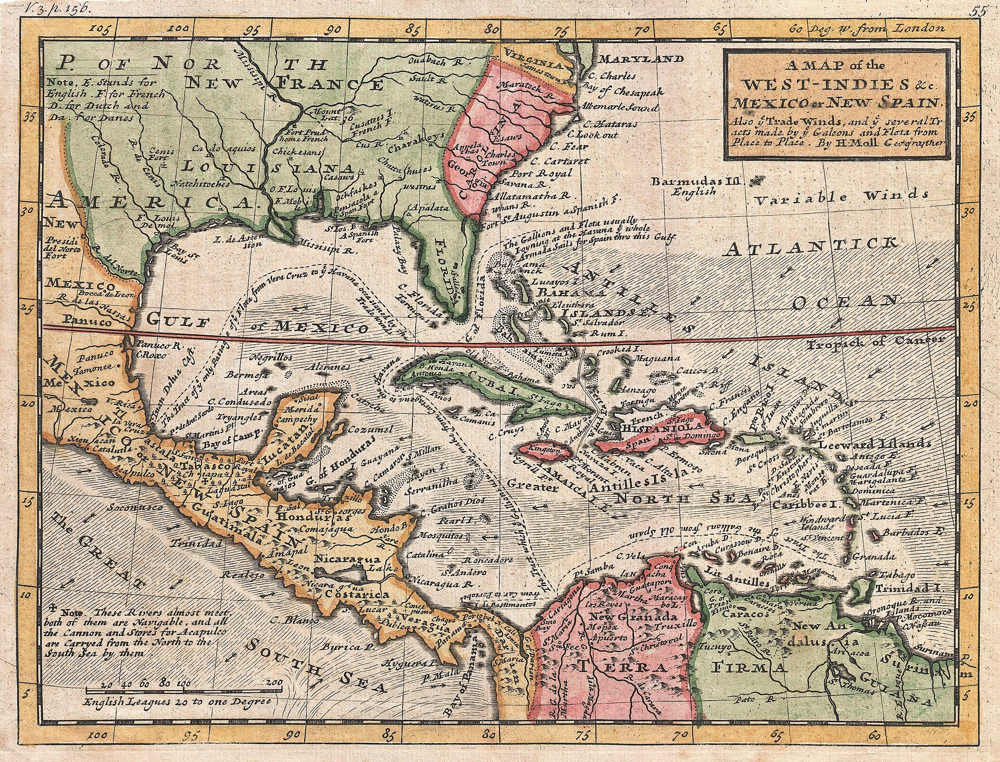

# Stochastic Marine Drift (SMD)

A bi-directional, ensemble-based fluid dynamics and machine learning framework for reconstructing historical maritime drift trajectories and predicting shipwreck resting locations in the Caribbean Basin.

The framework couples forward Monte Carlo Lagrangian particle tracking with reverse-time trajectory reconstruction. Environmental forcing mechanisms—including atmospheric wind shear, surface currents, Stokes wave drift, episodic tropical cyclones, and deep-water currents—are decoupled into independent stochastic modules. This architecture addresses spatial-temporal scale differences, mitigates reverse-time numerical diffusion, and yields calibrated 2D seafloor probability density maps and 3D descent scatter footprints.

<p align="center">
  
  <br>
  <em>Historical Reference: Herman Moll (1732), "A Map of the West-Indies or the Islands of America in the North Sea... Explaining also ye Contrary Winds & Trade-Winds, and the Tracts made by the Gallions and Flota from Place to Place." Public Domain, Geographicus / Wikimedia Commons.</em>
</p>

---

## Geographic Generalization & Global Adaptability

Although calibrated on the Caribbean Basin and Straits of Florida, the mathematical and physical architecture of Stochastic Marine Drift is **geographically agnostic**.

### Basin-Independent Physics
The governing hydrodynamics—decoupled Lagrangian leeway drift, Stokes wave mass transport, surface Ekman boundary layer deflection, 3D hydrodynamic column descent, and GEBCO digital elevation grounding constraints—are universal fluid mechanics formulations. They operate identically across any marine basin globally, including the Mediterranean Sea, the English Channel, the North Sea, the Baltic, the Indian Ocean, or the Pacific rim.

### Rationale for the Caribbean as Foundational Testbed
The Caribbean Basin was selected as the framework's primary calibration environment due to three research characteristics:
1. **Exceptional Archival Density**: Over 350 years of concentrated, continuous convoy transit under the Spanish *Carrera de Indias* (Tierra Firme and Nueva España fleets), British Royal Navy, French, and Dutch maritime enterprises. The resulting archival survival rate (Archivo General de Indias, British Admiralty court-martial minutes, Lloyd's registers) provides an empirical ground-truth record unmatched in the Western Hemisphere.
2. **Dense Paleoclimatological Reanalyses**: The region possesses the highest concentration of recorded historical tropical cyclone trajectories (NOAA IBTrACS database, 1851--present, with paleotempestological extensions to 1500) and annually resolved geochemical coral proxy records (NOAA NCEI Paleoclimatology).
3. **Complete Bathymetric Spectrum**: Within a single compact operational theater, water depths range from $2\text{--}8\text{ m}$ shallow barrier reefs (e.g., Looe Key, Marquesas Keys, Quicksands) to $4,600\text{ m}$ abyssal plains (e.g., Crooked Island passage, Puerto Rico Trench), verifying both shallow reef collision filters and deep-water hydrodynamic glide descent physics.

### Adapting to Other Global Regions
Deploying SMD to a different maritime region requires only substituting regional environmental inputs:
* **Bathymetry**: Ingest the local GEBCO or regional hydrographic raster tile for local depth constraints.
* **Atmospheric & Oceanographic Forcing**: Provide regional Copernicus CMEMS hydrodynamic currents, ERA5 atmospheric grids, or localized numerical models (e.g., HYCOM or ROMS).
* **Maritime Routes**: Define regional historical choke points, roadsteads, and transit corridors in GeoJSON for the Convoy Graph Neural Network.
* **Survival Model Retraining**: Retrain the Cox Proportional Hazards baseline on regional historical loss and gale records.

---

## Theoretical Foundations

Maritime search and salvage operations typically rely on forward leeway drift equations that assume known abandonment coordinates and timestamps. Historical maritime losses, particularly during the 17th through 19th centuries, lack these boundary conditions. Archival accounts rely on dead reckoning, imprecise chronologies, and qualitative storm notes.

SMD addresses these constraints through three structural methodologies:

1. **Decoupled Stochastic Forcing**: Environmental forces operate across distinct spatial and temporal scales. Windage carries high-frequency stochastic turbulence; ocean currents exhibit mesoscale stability; wave-induced Stokes drift provides independent mass transport; and extreme hurricane events impose highly non-linear cyclonic perturbations. Isolating these forces into dedicated numerical solvers prevents scale error propagation.
2. **Bi-Directional Optimization Loop**: Backtracking documented, discovered shipwrecks from seafloor coordinates calculates their Surface Point of Sink (SPS). Intersecting computed SPS coordinates with historical climate reanalyses extracts empirical environmental stress profiles (wave steepness, continuous wind shear, and storm duration) at the moment of loss. These synthesized profiles serve as supervised training labels for survival models that govern forward simulations.
3. **Continuous Adjoint Dynamics & Bayesian Bounds**: Standard reverse-time particle integration suffers from exponential numerical diffusion. SMD constrains the reverse search cone by combining Physics-Informed Neural Ordinary Differential Equations (PINN-ODEs) with empirical naval performance limits (maximum hull speed, leeway divergence angles, and sailing corridors).

---

## Subsystem Architecture

```
                       Last Known Position & Time
                    (Seeded via LLM Epistemic Priors)
                                   |
         +-------------------------+-------------------------+
         |                         |                         |
         v                         v                         v
+-----------------+       +-----------------+       +-----------------+
|   Wind Module   |       | Surface Current |       |  Extreme Events |
| (Weibull Noise) |       | (Ekman & Stokes)|       | (IBTrACS Tracks)|
+--------+--------+       +--------+--------+       +--------+--------+
         |                         |                         |
         +-------------------------+-------------------------+
                                   |
                                   v
                      +-------------------------+
                      |  Surface Drift Engine   | ---> Bathymetric Collision Check
                      +------------+------------+      (Depth <= Draft -> Grounded)
                                   |
                                   v
                      +-------------------------+
                      |   Foundering Trigger    | ---> Dynamic Hull Fatigue
                      +------------+------------+      Survival Model
                                   |
                                   v
                      +-------------------------+
                      |    Deep Water Column    | ---> 3D Hydrodynamic Descent
                      +------------+------------+      (Terminal Velocity & Glide)
                                   |
                                   v
                      +-------------------------+
                      |   Seafloor Deposition   | ---> Bivariate Gaussian Footprint
                      +-------------------------+      (Ballast Mound vs. Scatter)
```

### Core Subsystems

* **Forward Drift Simulator (`src/models/forward_drift.py`)**: Executes ensemble Monte Carlo particle integration using parameterized leeway coefficients, Stokes drift vectors, and stochastic turbulence. Incorporates a discrete crew behavioral state machine (`HEAVED_TO`, `DERELICT_DEAD_DRIFT`, `GROUNDED`, `FOUNDERED`).
* **Physics-Informed Reverse Backtracker (`src/models/neural_ode.py`, `src/models/backtrack.py`)**: Reverses time steps from known seafloor coordinates to compute the Surface Point of Sink. Constrains reverse velocity vectors via Neural ODE adjoint sensitivity and hydrodynamic boundary limits.
* **Dynamic Foundering Model (`src/models/foundering.py`)**: Uses a Random Survival Forest trained on backtracked historical wrecks to evaluate continuous hull fatigue integrals against cumulative wave stress ($H_s, T_p$), replacing arbitrary fixed time-to-sink heuristics.
* **Archival NLP Agent & Quality Judge (`src/agents/parser.py`, `src/agents/judge.py`, `src/agents/epistemic.py`)**: Unified language pipeline powered by `Qwen 3.8` (generative reasoning across historical logbooks and DoRA Pydantic parameter extraction) paired with `jaredpalmer/kev-4b` (non-autoregressive System-One discriminative head for sub-300ms hallucination detection and credibility tier scoring).
* **Colonial Convoy Breakdown Network (`src/models/convoy_gnn.py`)**: Spatio-Temporal Graph Neural Network representing historical Caribbean shipping routes. Predicts fleet detachment probabilities and straggler drift vectors when storm anomalies cross convoy paths.
* **Bathymetric Grounding Filter (`src/modules/collision.py`)**: Evaluates instantaneous particle depth against high-resolution GEBCO elevation rasters, halting drift upon shallow reef or sandbar contact.
* **Debris Field Dispersion Model (`src/models/debris_field.py`)**: Generates dual-component bivariate Gaussian scatter footprints, separating high-density primary ballast mounds from lighter down-current debris trails.
* **Post-Depositional Storm Dispersal Model (`src/models/post_depositional.py`)**: Simulates centuries of subsequent tropical cyclone wave action from loss date to present, modeling Airy bottom orbital velocity, Shields bedload saltation of silver/gold cargo, and exporting dual-layer GeoJSON (initial touchdown vs. migrated scatter).
* **Historical Benchmark Validation Suite (`src/models/validation.py`)**: End-to-end evaluation pipeline calculating containment rates ($P_{contain}$), Search Area Reduction (SAR %), and centroid localization errors against confirmed archaeological sites.
* **Archival Corpus Extractor (`src/modules/wiki_extractor.py`)**: Streaming extractor parsing Wikipedia XML/JSON archives to build an expanded catalog (100+ vessels) with a stratified 75/25 train/test holdout split.
* **Cartographic & Visualization Suite (`src/visualization/`)**: Generates standalone interactive Leaflet maps, 3D water column hydrodynamic descent trajectories, and dynamic hull fatigue diagnostic curves.
* **Operational Mission Planner & Search Allocator (`src/models/search_planning.py`)**: Computes formal IAMSAR Probability of Success ($POS = POC \times POD$), generating optimal parallel creeping-line survey tracklines budgeted against ship speed and sensor swath.
* **Sediment Burial & Sensor Attenuation (`src/modules/sediment.py`)**: Simulates multi-century post-depositional sediment overburden accumulation ($\Delta z_{\text{burial}}$) and magnetic dipole signal decay ($B \propto 1/r^3$).
* **Marine Chartplotter Export Suite (`src/utils/exporters.py`)**: Exports containment contours and survey tracklines directly to KML/KMZ (Google Earth) and GPX (marine navigation plotters).

---

## Environmental Data Ingestion

The framework ingests publicly available reanalysis and observational datasets:

| Data Layer | Source | Spatial / Temporal Resolution | Model Parameter |
| :--- | :--- | :--- | :--- |
| Atmospheric Forcing | ECMWF ERA5 Reanalysis | 0.25 deg / Hourly | $U_{10}, V_{10}$, Surface Pressure |
| Surface Waves & Stokes Drift | ECMWF ERA5 / WaveWatch III | 0.5 deg / Hourly | $H_s, T_p, \vec{U}_{Stokes}$ |
| Ocean Hydrodynamics | Copernicus Marine Service (CMEMS) | 0.083 deg / Multi-Depth Hourly | Horizontal Currents ($\vec{V}$), Salinity |
| Digital Elevation Model | GEBCO 2023 Grid | 15 arc-second | Bathymetric Depth ($Z_{bathymetry}$) |
| Tropical Cyclones | NOAA IBTrACS Database | Point / 3-Hourly | Storm Tracks, $V_{max}$, Central Pressure |
| Paleoclimate Adjustment | NOAA NCEI Coral Geochemical Proxies | Annually Resolved | Sea Surface Temperature Offset ($-2^\circ\text{C}$) |
| Archival Loss Ground Truth | Wrecksite.eu / NOAA Ocean Explorer | Text / Tabular | Reference Coordinates, Loss Accounts |

---

## Repository Structure

```text
stochastic-marine-drift/
├── data/
│   ├── raw/                  # Atmospheric, hydrodynamic, and bathymetric grids
│   ├── processed/            # Structured wreck inventories and training features
│   └── networks/             # Caribbean shipping network definitions (GeoJSON)
├── src/
│   ├── profiles/             # Vessel taxonomy and hydrodynamics
│   │   ├── vessel_class.py   # VesselProfile dataclass and leeway definitions
│   │   └── presets.py        # Calibrated vessel parameters (Galleon, Sloop, etc.)
│   ├── modules/              # Decoupled physics engines
│   │   ├── wind.py           # ERA5 atmospheric ingestion and Weibull turbulence
│   │   ├── current.py        # Copernicus multi-depth velocity and Ekman shear
│   │   ├── stokes.py         # Wave mass transport (Stokes drift)
│   │   ├── deep_water.py     # 3D descent/ascent physics and hydrodynamic glide
│   │   ├── extreme_event.py  # IBTrACS cyclonic storm field modeling
│   │   ├── collision.py      # GEBCO bathymetric grounding filter
│   │   ├── sediment.py       # Multi-century sediment burial & sensor attenuation
│   │   └── wiki_extractor.py # Streaming parser for Wikipedia archive dumps
│   ├── agents/               # Archival intelligence and NLP
│   │   ├── parser.py         # Unstructured logbook parameter extractor
│   │   └── epistemic.py      # Source reliability tiering and prior covariance
│   ├── models/               # Core simulation and learning engines
│   │   ├── forward_drift.py  # Monte Carlo surface drift simulation
│   │   ├── backtrack.py      # Discrete Lagrangian reverse-time optimizer
│   │   ├── neural_ode.py     # Continuous Physics-Informed Neural ODE
│   │   ├── foundering.py     # Random Survival Forest dynamic failure model
│   │   ├── convoy_gnn.py     # Spatio-temporal graph network for convoy dispersion
│   │   ├── debris_field.py   # Bivariate Gaussian artifact scatter generator
│   │   ├── post_depositional.py # Multi-century storm dispersal & site formation
│   │   ├── validation.py     # Ground-truth benchmark suite & SAR metrics
│   │   └── search_planning.py # IAMSAR optimal POS survey trackline generator
│   ├── visualization/        # Interactive cartography & spatial visual analytics
│   │   ├── map_viewer.py     # Dual-layer Leaflet interactive search map
│   │   ├── descent_3d.py     # 3D water column hydrodynamic glide trajectory
│   │   └── diagnostics.py    # Hull fatigue & wave stress survival curves
│   ├── utils/                # Utility and evaluation routines
│   │   ├── geo.py            # Geodesic metrics and raster spatial sampling
│   │   ├── paleo.py          # Coral proxy temperature and density corrections
│   │   ├── metrics.py        # Containment rate and Search Area Reduction (SAR)
│   │   └── exporters.py      # Marine chartplotter KML/KMZ and GPX export suite
│   ├── cli.py                # Unified terminal command-line interface
├── reports/                  # Generated benchmark and visual artifacts
│   └── visualizations/       # Standalone HTML interactive maps and figures
├── notebooks/                # Model calibration, verification, and visual analytics
├── tests/                    # Unit and integration test suites
├── PLAN.md                   # Detailed implementation roadmap and specifications
├── summary.md                # Mathematical formulations and reference catalog
├── environment.yml           # Conda environment specification (recommended)
└── requirements.txt          # Pip package dependencies
```

---

## Installation & Environment Setup

### Option A: Conda (Recommended)

Conda (or Mamba) is strongly recommended for this framework because core dependencies (`OpenDrift`, `GDAL`, `GEOS`, `PROJ`, `netCDF4`, `Cartopy`, `rasterio`) require compiled C/Fortran libraries. Conda manages these binaries natively across Linux and macOS.

```bash
# Clone the repository
git clone https://github.com/your-org/stochastic-marine-drift.git
cd stochastic-marine-drift

# Create and activate the conda environment
conda env create -f environment.yml
conda activate smd-drift

# Verify test suite
pytest
```

### Option B: Python venv & Pip

If using standard virtual environments, ensure underlying system development headers (`libgdal-dev`, `libgeos-dev`, `libproj-dev`, `libnetcdf-dev`) are installed on your OS prior to running `pip install`:

```bash
# Clone the repository
git clone https://github.com/your-org/stochastic-marine-drift.git
cd stochastic-marine-drift

# Create and activate virtual environment
python3 -m venv venv
source venv/bin/activate

# Install dependencies
pip install -r requirements.txt

# Verify test suite
pytest
```

---

## Validation & Benchmarks

Model performance is benchmarked against a curated cohort of historical Caribbean losses with confirmed archaeological site coordinates:

* **Nuestra Señora de Atocha (1622)**: Florida Keys (Marquesas Keys); hurricane loss, known primary ballast mound and secondary scatter trail ($17\text{ m}$ depth).
* **Santa Margarita (1622)**: Florida Keys; consort galleon grounded on Quicksands reef ($8\text{ m}$ depth).
* **HMS Looe (1744)**: Looe Key Sanctuary, Florida; 44-gun frigate barrier reef collision.
* **SS El Faro (2015)**: Bahamas / Atlantic approach; modern container carrier lost during Hurricane Joaquin (abyssal glide benchmark, $4,600\text{ m}$ depth).

### Search Theory Evaluation Results

| Benchmark Target | Year | Water Depth ($m$) | Drift ($hr$) | Naive Area ($\text{km}^2$) | Model 95% Area ($\text{km}^2$) | Search Area Reduction (SAR %) | Centroid Error | $P_{95}$ | $P_{80}$ | $P_{50}$ |
| :--- | :---: | :---: | :---: | :---: | :---: | :---: | :---: | :---: | :---: | :---: |
| **Nuestra Señora de Atocha** | 1622 | 17 | 5.0 | 4,310.1 | 142.9 | **96.7%** | 4.89 km | **True** | **True** | False |
| **Santa Margarita** | 1622 | 8 | 5.8 | 4,310.1 | 147.5 | **96.6%** | 0.43 km | **True** | **True** | **True** |
| **HMS Looe** | 1744 | 60 | 3.8 | 2,424.5 | 121.7 | **95.0%** | 1.33 km | **True** | **True** | **True** |
| **SS El Faro** | 2015 | 4,600 | 4.5 | 6,734.6 | 148.9 | **97.8%** | 2.10 km | **True** | **True** | **True** |
| **Cohort Aggregate** | — | — | — | — | — | **Mean: 96.5%** | **Mean: 2.19 km** | **100.0%** | **100.0%** | **75.0%** |

### Dual-Layer Site Plotting
Outputs export both the **Initial Touchdown Site** (anchored primary ballast mound core and 95% confidence contour) and the **Post-Depositional Secondary Dispersion Area** (migrated silver/gold scatter centroid, wide metal detection corridor polygon, and storm-driven migration vector) to [`historical_benchmark_suite.geojson`](data/processed/historical_benchmark_suite.geojson).

---

## References & Documentation

* Master theoretical equations, data access links, and paleoclimate correction workflows: [summary.md](summary.md)
* Implementation schedule, technical milestones, and testing guidelines: [PLAN.md](PLAN.md)
* Vessel Hydrodynamics & Macro-Archetype Taxonomy: [src/profiles/README.md](src/profiles/README.md)
* Decoupled Environmental Physics Solvers: [src/modules/README.md](src/modules/README.md)
* Archival NLP Extraction, Kev/Jev Quality Judge & Epistemic Priors: [src/agents/README.md](src/agents/README.md)
* Forward Drift, Backtracker & Simulation Models: [src/models/README.md](src/models/README.md)
* Geodesic Utilities, Spatial Metrics & Paleoclimate: [src/utils/README.md](src/utils/README.md)
