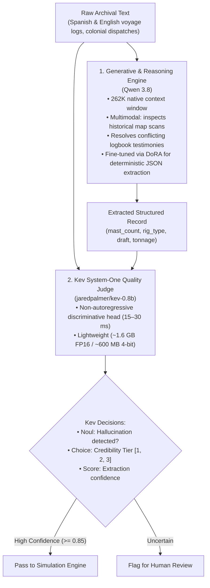

# Archival Intelligence, LLM Parsers & Kev Quality Judges (`src/agents/`)

This package bridges the gap between unstructured historical maritime archives (logbooks, court-martial inquiries, colonial governor dispatches) and quantitative fluid dynamics simulation.

---

## 1. Dual-Model Architecture: Qwen 3.8 + Kev Quality Judge

The language processing pipeline consolidates all generative intelligence into a single foundational model (`Qwen 3.8`) paired with an ultra-fast discriminative verification judge (`jaredpalmer/kev-0.8b`):

---

## 2. Kev / Jev System-One Decision Protocol

**Kev** (open-source on Hugging Face, built on Qwen bases) and **Jev** (TypeSafe AI) are non-autoregressive discriminative decision models:
* Instead of slow token-by-token generation, `kev-0.8b` evaluates state and questions in **15 to 30 milliseconds**.
* **`Noul` (Boolean)**: Verifies whether extracted numbers (tonnage, mast count) are grounded in the source text without hallucination.
* **`Choice`**: Categorizes archival provenance into credibility tiers with calibrated probability distributions.

---

## 3. Epistemic Uncertainty Prior Calibration

Historical records have varying degrees of reliability. The epistemic calibrator maps the provenance tier directly to the initial spatial variance $\mathbf{\Sigma}_0$ and temporal variance $\sigma_t^2$ used to seed Monte Carlo particle swarms:

| Credibility Tier | Provenance Type | Spatial Radius ($1\sigma$) | Temporal Uncertainty ($1\sigma$) | Rationale |
| :--- | :--- | :--- | :--- | :--- |
| **Tier 1** | Eyewitness Captain's Journal | $2.0\text{ nmi}$ ($\approx 3.7\text{ km}$) | $1.0\text{ hr}$ | Direct observation of loss location |
| **Tier 2** | Escort Convoy Sighting | $8.0\text{ nmi}$ ($\approx 14.8\text{ km}$) | $6.0\text{ hrs}$ | Sighted by companion ship before separation |
| **Tier 3** | Retrospective Colonial Inquest | $30.0\text{ nmi}$ ($\approx 55.6\text{ km}$) | $48.0\text{ hrs}$ | Third-party accounts recorded months later |

---

## 4. Decoupled Host URLs & Hugging Face Hosting

All agent scripts connect via standard OpenAI-compatible endpoints (`/v1/chat/completions` and `/v1/systemone`):
* Configure `LLM_HOST_URL` in `.env` to point to:
  - Local `vLLM` server: `http://localhost:8000/v1`
  - Local `Ollama` server: `http://localhost:11434/v1`
  - Free Hugging Face Serverless Endpoint: `https://api-inference.huggingface.co/v1`
* Users can fine-tune `Qwen 3.8` using [`train_domain_model.py`](train_domain_model.py) with **DoRA (Weight-Decomposed Low-Rank Adaptation)** and push weights directly to their Hugging Face Model Hub repository or serve locally via vLLM.
