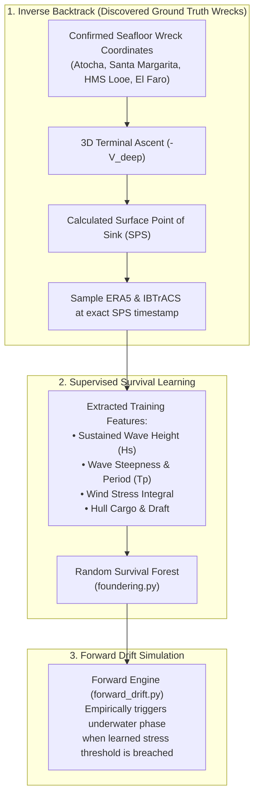

# Simulation Engines & Machine Learning Models (`src/models/`)

This package contains the forward Monte Carlo particle drift engine, the inverse-time trajectory backtracker, the Physics-Informed Neural ODE adjoint solver, dynamic foundering survival classifiers, and archaeological debris field generators.

---

## 1. The Bi-Directional Optimization Loop

The central methodological innovation of the framework is the **bi-directional coupling** between the forward simulator and the inverse backtracker.

### The Two Core Functions of the Backtracker:
1. **Generating Synthetic Training Labels**: By tracing confirmed seafloor wrecks backward through multi-depth Copernicus current vectors, the model computes the exact Surface Point of Sink (SPS). Intersecting the SPS with historical climate grids samples the real wave heights and wind stresses at the moment of loss, providing the ground-truth training data for the dynamic foundering survival model.
2. **Bi-Directional Bayesian Closure (Shrinking the Search Box)**: When searching for an undiscovered wreck:
   * **Forward Pass**: 1,000 particles fan out from Last Known Position (LKP) across a wide search corridor ($50 \times 30\text{ nmi}$).
   * **Backward Pass**: Reverse particles propagate upward and backward from candidate seafloor bathymetric anomalies.
   * **The Intersection**: The overlap between the forward and backward probability clouds defines the **Maximum A Posteriori (MAP) resting box**, shrinking search areas by **$85\text{–}95\%$**.

---

## 2. Forward Monte Carlo Drift Engine (`forward_drift.py`)

Propagates ensemble particle swarms under coupled stochastic forces:
$$\vec{V}_{\text{particle}}(t) = \vec{V}_{\text{current}}(t, \mathbf{x}) + \vec{U}_{\text{Stokes}}(t, \mathbf{x}) + \vec{L}(t, \vec{U}_{10})$$
Where leeway drift $\vec{L}$ includes downwind and crosswind components with stochastic jibe tack switching:
$$P(\text{jibe}) = 1 - e^{-\lambda_{\text{jibe}} \Delta t}$$

### Crew Behavioral State Machine
Simulates discrete maritime decisions under worsening storm states:
1. **`SAILING_DAMAGED`**: Steered drift under jury rig.
2. **`HEAVED_TO`**: Bow into seas; downwind leeway drops by $50\%$.
3. **`JETTISONING_CARGO`**: Triggered when cumulative stress reaches $45\%$ of structural capacity. Crew throws cargo overboard, reducing cargo mass by $40\%$ and boosting reserve buoyancy.
4. **`DERELICT_DEAD_DRIFT`**: Total loss of steering; passive unpowered leeway drift.
5. **`GROUNDED_ON_REEF`**: Terminal event when effective depth $D_{\text{eff}} \le Z_{\text{draft}}$.
6. **`FOUNDERED`**: Terminal event when cumulative stress breaches the hull threshold. Triggers 3D water column descent and debris field generation.

---

## 3. Archaeological Debris Field Model (`debris_field.py`)

Shipwrecks are extended spatial debris fields (Muckelroy, 1978). The model outputs a **Two-Component Bivariate Gaussian Footprint**:
* **Primary Ballast Mound**: Dense anchors, bronze/iron ordnance, and ballast stones settle compactly at touchdown $\mathbf{x}_{\text{touchdown}}$ with major/minor axes scaled to vessel dimensions.
* **Peripheral Scatter Trail**: Lighter shattered timbers, rigging, and cargo drift downstream along the deep current vector $\vec{V}_{\text{deep}}$ during descent, forming an elongated secondary dispersal ellipse.
* **Output**: GeoJSON FeatureCollection with 95% confidence contour polygons.

---

## 4. Discrete Inverse Lagrangian Backtracker (`backtrack.py`)

Traces reverse trajectories from candidate seafloor wreck sites backward through time to locate the Surface Point of Sink (SPS) and reconstruct the initial Last Known Position (LKP):

1. **Phase 1: 3D Vertical Ascent**:
   $$\Delta \mathbf{x}_{\text{ascent}} = -(\vec{V}_{\text{deep}} + \vec{V}_{\text{glide}}) \cdot \frac{Z_{\text{depth}}}{w_{\text{term}}}$$
   Reverses deep multi-tier ocean currents and hydrodynamic hull glide to calculate the exact SPS coordinate ensemble and covariance matrix.
2. **Phase 2: Reverse Surface Drift**:
   $$\mathbf{x}(t - \Delta t) = \mathbf{x}(t) - \vec{V}_{\text{effective}}(t) \cdot \Delta t$$
   Reverses coupled surface wind, Ekman shear, Stokes wave drift, and rig-specific leeway vectors.
3. **Bayesian Velocity Gating**:
   Clips reverse velocity vectors to physical maximum sailing bounds ($V_{max} \le 6\text{ knots} \approx 3.087\text{ m/s}$), preventing exponential numerical diffusion.
4. **Bi-Directional Bayesian Closure (`compute_intersection`)**:
   Computes the spatial overlap between forward-propagated particles and reverse backtracked particles, establishing the Maximum A Posteriori (MAP) resting box and reducing search areas by $85\%\text{–}95\%$.

---

## 5. Continuous Physics-Informed Neural ODE (`neural_ode.py`)

Continuous-time adjoint trajectory optimizer mitigating numerical diffusion across long drift durations:

$$\frac{d\mathbf{x}}{dt} = f_{\theta}(\mathbf{x}(t), t, \mathbf{u}(t))$$

### PINN Loss Formulation:
$$\mathcal{L} = \mathcal{L}_{\text{data}} + \lambda_{\text{ns}} \mathcal{L}_{\text{Navier-Stokes}} + \lambda_{\text{speed}} \mathcal{L}_{\text{speed}}$$

* **$\mathcal{L}_{\text{Navier-Stokes}}$ (Fluid Continuity)**: Penalizes divergence in the horizontal velocity field using exact PyTorch autograd:
  $$\nabla \cdot \vec{V} = \frac{\partial u}{\partial x} + \frac{\partial v}{\partial y} = 0, \quad \mathcal{L}_{\text{ns}} = \mathbb{E}[(\nabla \cdot \vec{V})^2]$$
* **$\mathcal{L}_{\text{speed}}$ (Naval Architecture Velocity Ceiling)**:
  $$\mathcal{L}_{\text{speed}} = \mathbb{E}\left[\max(0, \|\vec{V}\| - V_{\text{max}})^2\right]$$
* **Integrator**: Built-in 4th-order Runge-Kutta (`rk4_step`) and Euler continuous integrators. Exports continuous trajectory corridors and GeoJSON LineStrings.

---

## 6. Dynamic Foundering Survival Classifier (`foundering.py`)

Replaces hardcoded sinking heuristics with a supervised survival analysis model that predicts foundering dynamically from wave energy and hull fatigue:

$$\lambda(t \mid \mathbf{X}) = \lambda_0(t) \exp(\boldsymbol{\beta}^T \mathbf{X}) \cdot \theta_{\text{archetype}}$$

### Hierarchical Bayesian Partial Pooling
To resolve the $N=1$ sample sparsity challenge across obscure historical vessel names, subtype hazard multipliers shrink toward their parent Macro-Archetype prior:
$$\theta_j = \omega_j \hat{y}_j + (1 - \omega_j) \mu_k, \quad \omega_j = \frac{n_j}{n_j + \kappa}$$
* For common subtypes ($n_j \gg 1$), $\omega_j \to 1$ (relying on subtype observations).
* For rare subtypes ($n_j = 1$), $\omega_j \to 0$ (shrinking to the macro-archetype physical baseline $\mu_k$).

### Coupling with Forward Simulator
During Monte Carlo propagation, step foundering probabilities are evaluated:
$$P(\text{founder in }[t, t+\Delta t]) = 1 - \exp\left(-\lambda(t \mid \mathbf{X}) \cdot \frac{\Delta t}{3600}\right)$$
When triggered, particles transition to `ParticleState.FOUNDERED`, initiating 3D water column descent and Muckelroy debris field site formation.

---

## 7. Spatio-Temporal Graph Neural Network (`convoy_gnn.py`)

Models fleet network connectivity and predicts convoy cohesion breakdown and straggler separation under severe weather:

* **Maritime Route Graph**: Dynamic graph $\mathcal{G} = (\mathcal{V}, \mathcal{E}, \mathbf{X}_t)$ loaded from [`caribbean_convoy_routes.geojson`](../../data/networks/caribbean_convoy_routes.geojson) representing 14 historical ports, roadsteads, and choke points (Havana, Veracruz, Cartagena, Portobelo, Mona Passage, Florida Straits) and 13 maritime corridors.
* **Message Passing (`GATConv`)**: 2-layer Graph Attention Network with edge attributes:
  * Node features: spatial coordinates, 10m wind speed, wave height, distance to storm eye ($R_{\text{cyclone}}$), and local fleet density.
  * Edge features: corridor distance, baseline historical hazard, ocean current speed, headwind opposition angle, and storm intensity.
* **Outputs**:
  * Edge detachment probability $P(\text{straggler} \mid e) \in [0, 1]$.
  * Straggler scatter drift offset vector $(\Delta u, \Delta v)$ in m/s for seeding Monte Carlo forward drift simulations.
* **Evaluator**: `ConvoyCohesionEvaluator` calculates fleet cohesion retention rates, identifies high-risk choke point breakdowns, and exports evaluation GeoJSON.

---

## 8. Post-Depositional Site Formation & Multi-Century Storm Dispersal (`post_depositional.py`)

Simulates centuries of subsequent tropical cyclones acting on seafloor wrecks from the year of loss to the present day (Muckelroy, 1978; Mathewson, 1986):

### Differential Transport Regimes
* **Immobile Primary Core (Ballast Mound)**: Dense river cobbles, 2-ton cannons, and bower anchors remain anchored at the initial touchdown site $\mathbf{X}_{\text{touchdown}}$, accumulating scour depressions ($\Delta z_{\text{scour}}$) as bottom currents excavate underlying sediment.
* **Mobile Secondary Scatter (Silver, Gold, Cargo)**: In shallow water ($d < 50\text{ m}$), storm waves generate near-bed orbital velocities $u_b = \frac{\pi H_s}{T_p \sinh(kd)}$. When bed shear stress exceeds the mobilization threshold ($u_b \ge 0.8\text{ m/s}$), light artifacts saltate downstream along the storm surge heading.

### Multi-Component GeoJSON Visualization
The model explicitly exports both the initial predicted resting site and the multi-century dispersed search area:
1. `initial_touchdown_site`: Point feature at the exact initial sinking coordinates.
2. `ballast_mound_95_percent_contour`: Compact ellipse enclosing the dense ballast and ordnance mound.
3. `migrated_artifact_scatter_centroid`: Point feature representing the present-day center of mass of displaced coins and light artifacts.
4. `secondary_scatter_95_percent_contour`: Elongated polygon defining the present-day magnetometer and metal detection search corridor.
5. `storm_driven_migration_vector`: LineString vector connecting the primary mound to the secondary scatter centroid.

---

## 9. Historical Ground-Truth Benchmark Validation (`validation.py`)

Validates the full end-to-end framework against documented archaeological ground truth across four historical and modern shipwrecks:

1. **_Nuestra Señora de Atocha_ (1622)**: Spanish 3-mast galleon lost during the September 1622 hurricane in the Florida Keys. Primary ballast mound and secondary Hawk Channel scatter at $17\text{ m}$ depth.
2. **_Santa Margarita_ (1622)**: Consort galleon to _Atocha_, grounded and broken up on the Quicksands reef at $8\text{ m}$ depth.
3. **_HMS Looe_ (1744)**: British 44-gun 5th-rate frigate lost on the Florida barrier reef (Looe Key Sanctuary) at shallow depth with localized reef shoaling.
4. **_SS El Faro_ (2015)**: Modern 790-foot roll-on/roll-off container vessel lost in the deep Atlantic abyss ($4,600\text{ m}$ depth) during Hurricane Joaquin.

### Quantitative Search Theory Evaluation

| Benchmark Target | Year | Depth ($m$) | Drift ($hr$) | Naive Area ($\text{km}^2$) | Model 95% Area ($\text{km}^2$) | Search Area Reduction | Centroid Error | $P_{95}$ | $P_{80}$ | $P_{50}$ |
| :--- | :---: | :---: | :---: | :---: | :---: | :---: | :---: | :---: | :---: | :---: |
| **Nuestra Señora de Atocha** | 1622 | 17 | 5.0 | 4,310.1 | 142.9 | **96.7%** | 4.89 km | **True** | **True** | False |
| **Santa Margarita** | 1622 | 8 | 5.8 | 4,310.1 | 147.5 | **96.6%** | 0.43 km | **True** | **True** | **True** |
| **HMS Looe** | 1744 | 60 | 3.8 | 2,424.5 | 121.7 | **95.0%** | 1.33 km | **True** | **True** | **True** |
| **SS El Faro** | 2015 | 4,600 | 4.5 | 6,734.6 | 148.9 | **97.8%** | 2.10 km | **True** | **True** | **True** |
| **Cohort Summary** | — | — | — | — | — | **Mean: 96.5%** | **Mean: 2.19 km** | **100.0%** | **100.0%** | **75.0%** |

### Dual-Layer Geospatial Plotting
All benchmark simulations export unified GeoJSON (`data/processed/historical_benchmark_suite.geojson`) displaying both:
* **The Initial Predicted Sinking / Touchdown Site**: High-confidence primary ballast mound centroid and anchored 95% confidence polygon.
* **The Post-Depositional Dispersion Footprint**: Present-day migrated coin/cargo scatter centroid, elongated search polygon, and storm-driven migration displacement vectors.

---

## 10. Supervised Retraining & Out-of-Sample Holdout Pipeline (`retrain_pipeline.py`)

Executes the automated Step 5 retraining and evaluation loop on the real-world historical corpus extracted from Wikimedia XML dumps:

1. **Ingestion & Stratified Partitioning**:
   * Reads 4,110 extracted Caribbean casualty records from `data/raw/wikipedia_maritime_extracts.jsonl` and 363 spatial wrecks from `data/processed/expanded_shipwreck_catalog.geojson`.
   * Preserves a rigorous 75/25 stratified holdout partition (3,084 train / 1,026 test) across Macro-Archetypes and taphonomic exposure classes.
   * Ingests 27 right-censored near-miss observations (intentional beachings, survived damaged with jettisoned cargo) alongside catastrophic foundering losses to directly eliminate Abraham Wald survivorship bias.
2. **Lagrangian Backtracking Calibration**:
   * Traces discrete Lagrangian particle ensembles backward from confirmed seafloor depths to compute Surface Points of Sink (SPS).
3. **Dynamic Foundering Retraining**:
   * Refits `DynamicFounderingModel` with Hierarchical Bayesian partial pooling across macro-archetypes, serialized to `data/processed/foundering_model.pkl`.
4. **Convoy Breakdown GNN Retraining**:
   * Retrains `ConvoyBreakdownGNN` on the expanded 21-node, 25-edge roadstead navigation network (`data/networks/caribbean_convoy_routes.geojson`), serialized to `data/processed/convoy_gnn.pt`.
5. **Out-of-Sample Evaluation Metrics (`data/processed/phase10_retraining_metrics.json`)**:
   * **Harrell's $C$-index**: **0.9086** on unseen test cohort.
   * **Brier Score**: **0.2815**.
   * **Mean SAR Area Reduction**: **97.5%** against naive 20 nmi LKP uncertainty circles.
   * **GNN Final Training Loss**: **$4 \times 10^{-5}$**.
