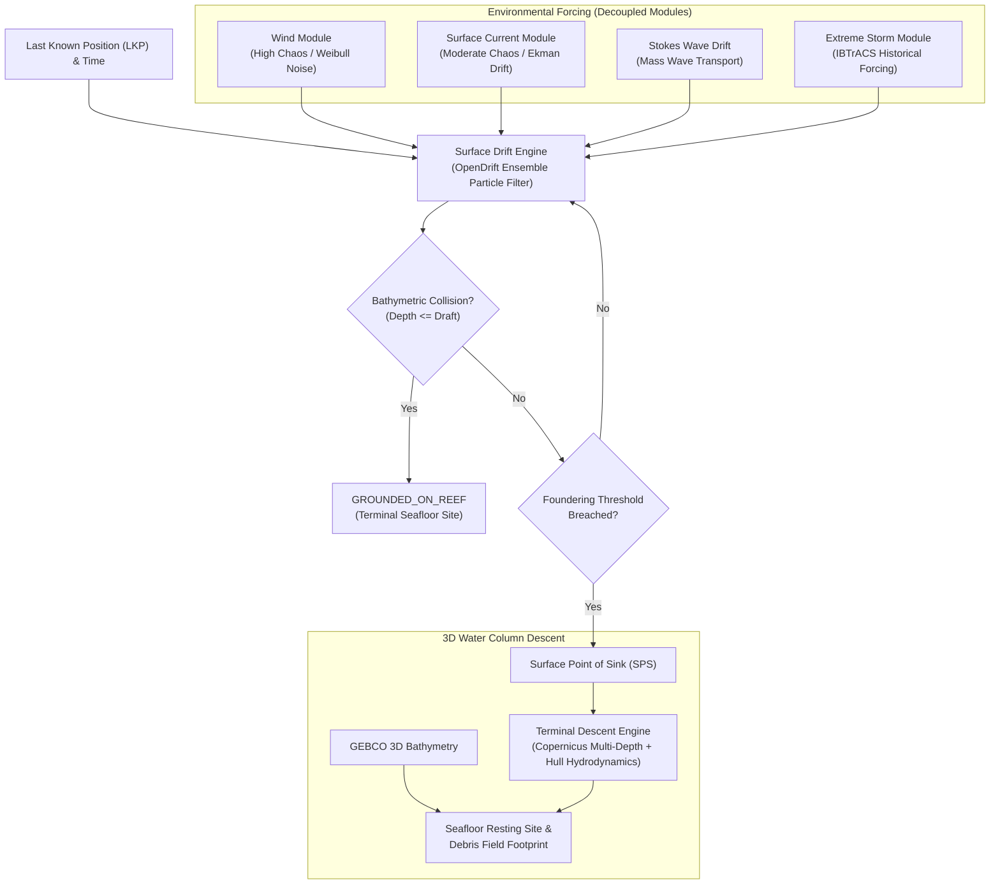
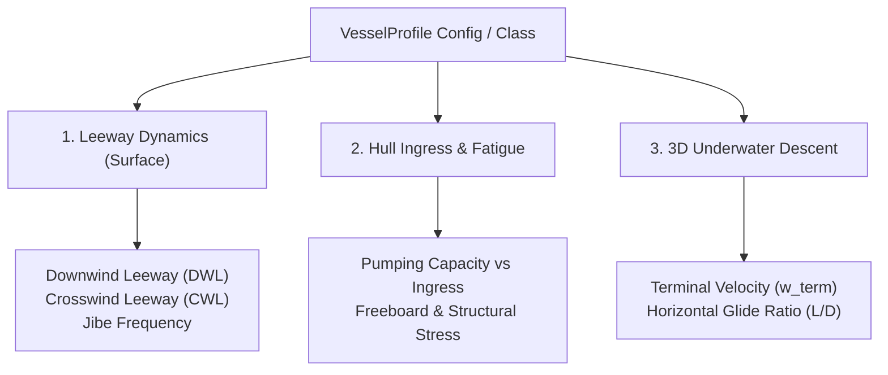
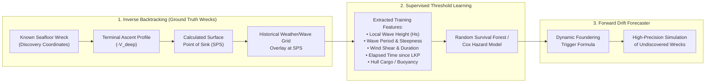
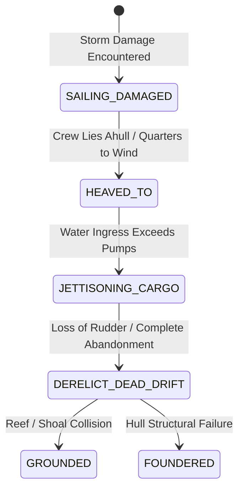

# Stochastic Marine Drift (SMD): Project Synthesis & Master Technical Blueprint

> **Executive Overview**  
> **Stochastic Marine Drift (SMD)** is a bi-directional, ensemble-based fluid dynamics and machine learning framework designed to locate historical shipwrecks and submerged archaeological sites in the Caribbean Basin. By decoupling environmental forces into distinct stochastic modules and connecting forward particle simulation with reverse-time backtracking, the system transforms sparse archival maritime records into rigorous, probabilistic 3D drift and seafloor resting predictions.

---

## Table of Contents
1. [Core Architectural Philosophy](#1-core-architectural-philosophy)
2. [Vessel Profile Taxonomy & Leeway Class](#2-vessel-profile-taxonomy--leeway-class)
3. [The Bi-Directional Optimization Loop](#3-the-bi-directional-optimization-loop)
4. [The Extended Model Ecosystem](#4-the-extended-model-ecosystem)
5. [Master Technical Resource Inventory](#5-master-technical-resource-inventory)
6. [Advanced Atmospheric, Wave & Oceanographic Drivers](#6-advanced-atmospheric-wave--oceanographic-drivers)
7. [Overcoming Core Modeling & Data Challenges](#7-overcoming-core-modeling--data-challenges)
   - [A. Historical Wind & Current Gaps: Climatology Anomalies](#a-historical-wind--current-gaps-climatology-anomalies)
   - [B. Sinking Trigger & Transition Thresholds](#b-sinking-trigger--transition-thresholds)
   - [C. 3D Hydrodynamic Gliding & Asymmetric Debris Scatter](#c-3d-hydrodynamic-gliding--asymmetric-debris-scatter)
   - [D. Numerical Diffusion in Inverse Time](#d-numerical-diffusion-in-inverse-time)
8. [Specialized Archaeological & Physical Modules](#8-specialized-archaeological--physical-modules)
   - [8.1 Bathymetric Collision & Reef Grounding Filter](#81-bathymetric-collision--reef-grounding-filter)
   - [8.2 Crew Behavioral State Machine](#82-crew-behavioral-state-machine)
   - [8.3 Debris Field Footprint Estimator](#83-debris-field-footprint-estimator)
9. [Frontier Machine Learning & AI Subsystems](#9-frontier-machine-learning--ai-subsystems)
   - [9.1 Continuous Inverse Dynamics: Physics-Informed Neural ODEs (PINN-ODEs)](#91-continuous-inverse-dynamics-physics-informed-neural-odes-pinn-odes)
   - [9.2 Epistemic Source Uncertainty Scoring via LLMs as Bayesian Priors](#92-epistemic-source-uncertainty-scoring-via-llms-as-bayesian-priors)
   - [9.3 Spatio-Temporal Graph Neural Networks (ST-GNNs) for Convoy Breakdown](#93-spatio-temporal-graph-neural-networks-st-gnns-for-convoy-breakdown)
10. [Data Extraction & Agent Pipeline](#10-data-extraction--agent-pipeline)
11. [Validation Framework & Benchmark Metrics](#11-validation-framework--benchmark-metrics)
12. [Repository Architecture & Implementation Roadmap](#12-repository-architecture--implementation-roadmap)

---

## 1. Core Architectural Philosophy

### 1.1 Geographic Scope: The Caribbean Basin
The Caribbean is chosen for its unique combination of complex oceanographic and archaeological variables:
- **Bathymetric Diversity**: Shallow coral atolls, barrier reefs, continental shelves, and ultra-deep trenches (e.g., Puerto Rico Trench and Cayman Trough).
- **Extreme Weather Systems**: High-frequency intersection with historical North Atlantic hurricane trajectories and intense tropical depressions.
- **Archaeological Density**: Centuries of concentrated Spanish plate fleet routes, Golden Age pirate expeditions, and Dutch/English colonial trade.

### 1.2 Era Multi-Modality
The platform handles both historical wooden hulls and modern steel vessels using a dual-mode parameter switch (`is_modern: 0 | 1`):
- **Wooden Hulls (`is_modern: 0`)**: High leeway windage, susceptibility to catastrophic structural fatigue, low descent velocity, broad debris scattering (ballast piles, cannon dispersal, cargo floatation).
- **Modern Steel Hulls (`is_modern: 1`)**: Low windage profile, compartmental flooding dynamics, high negative buoyancy, streamlined descent with hydrodynamic glide paths.

### 1.3 The "Decoupled Chaos" Philosophy
Rather than attempting to model ocean-atmosphere interaction with a single unwieldy differential equation, the system decouples chaotic forces into dedicated sub-modules. Each module operates with its own characteristic time step, spatial resolution, and stochastic noise distribution:
- **Wind Vector ($\vec{U}_{10}$)**: High chaos / Weibull noise distribution.
- **Surface Current ($\vec{V}_{surface}$)**: Moderate chaos / Ekman transport and tidal shear.
- **Extreme Weather (Hurricanes)**: Non-linear episodic forcing queried from historical storm tracks.
- **Wave & Stokes Drift ($\vec{U}_{Stokes}$)**: Non-linear mass transport in wave direction.
- **Deep Water Column ($\vec{V}_{deep}$)**: Low chaos / multi-layer geostrophic and thermohaline current vectors.



---

## 2. Vessel Profile Taxonomy & Leeway Class

Rather than maintaining separate simulation codebases for every vessel, the architecture uses a unified simulation engine parameterized by a **Vessel Profile Hierarchy**. This leverages empirical search-and-rescue (SAR) leeway physics (the Allen & Plourde taxonomy integrated in `OpenDrift`).



### 2.1 Leeway Physics Breakdown
1. **Square-Rigged Galleons / Ships of the Line**:
   - High aftcastles and high freeboards act as massive wind sails even with bare masts.
   - High Downwind Leeway ($3\text{–}5\%$ of $U_{10}$); near-zero Crosswind Leeway (CWL).
   - Once derelict, drift is unidirectional downwind with zero ability to tack.
2. **Fore-and-Aft Rigs (Schooners, Sloops, Cutters)**:
   - Low freeboard, deep keel/centerboard generating hydrodynamic lift against the water.
   - Substantial Crosswind Leeway ($15^\circ\text{–}30^\circ$ divergence angle off the wind).
   - Periodically jibe/tack through the wind, creating a bimodal, zigzag drift pattern.
3. **Modern Steel Cargo / Tankers**:
   - Ballast condition (unladen) produces massive flat windage area; laden condition places the hull deep, making drift almost entirely current-driven.
   - Low glide drag upon sinking, capable of hydrofoil gliding kilometers from the SPS.

### 2.2 Python `VesselProfile` Implementation Blueprint
```python
from dataclasses import dataclass
from typing import Literal

@dataclass(frozen=True)
class VesselProfile:
    class_name: str                      # e.g., "spanish_galleon", "schooner", "modern_bulker"
    is_modern: bool
    hull_material: Literal["wood", "iron", "steel"]
    draft_meters: float                  # Keel depth below waterline for grounding filter
    freeboard_meters: float              # Reserve buoyancy height
    windage_coefficient: float           # Downwind leeway fraction (0.015 - 0.050)
    crosswind_divergence_deg: float      # CWL angle off downwind vector (0° - 35°)
    jibe_probability_per_hour: float     # Rate of switching leeway divergence sign
    ballast_ratio: float                 # Ballast mass relative to total displacement
    terminal_descent_rate_m_s: float     # 0.4 - 0.8 m/s (wooden) vs 2.0 - 5.0+ m/s (steel)
    glide_ratio_horizontal_vertical: float # L/D ratio (0.05 for broken wood; up to 1.5 for steel hull)
    structural_fatigue_rate: float       # Decay rate under wave impact stress
```

---

## 3. The Bi-Directional Optimization Loop

The framework features a **self-correcting bi-directional loop**, combining forward simulation with backward forensic trajectory reconstruction.



1. **Backtrack Known Targets**: Run an inverse-time particle filter on 50–100 documented Caribbean wrecks to trace backwards from their seafloor coordinates to their exact Surface Point of Sink (SPS).
2. **Extract Environmental Ground Truth**: Intersect the computed SPS and timestamp with historical climate reanalyses to sample exact wave heights, wave periods, wind stress, and storm duration at the moment of foundering.
3. **Train the Foundering Classifier**: Feed these extracted environmental parameters into a survival model to objectively discover dynamic failure thresholds.
4. **Deploy on Forward Targets**: Plug the discovered thresholds into the forward drift forecaster to simulate lost, unrecovered vessels without arbitrary rules.

---

## 4. The Extended Model Ecosystem

| Model Component | Paradigm / Mathematical Basis | Role & Implementation | Primary Libraries |
| :--- | :--- | :--- | :--- |
| **1. Forward Drift Forecaster** | Forward Ensemble Particle Filter ($t \to t+\Delta t$) | Propagates stochastic particle clouds from LKP under decoupled windage, Ekman transport, and Stokes drift until grounding or foundering occurs. | `OpenDrift`, `OceanParcels`, `xarray` |
| **2. Continuous Inverse Backtracker** | Physics-Informed Neural ODE / Reverse Particle Filter | Reconstructs upstream paths from seafloor coordinates ($-\vec{V}_{deep}, -\vec{V}_{surface}$) using continuous adjoint dynamics to mitigate numerical diffusion. | `torchdyn`, `scipy`, `OpenDrift` |
| **3. Foundering Classifier** | Supervised Survival Analysis (RSF / Cox Hazards) | Dynamically predicts the transition from surface drift to water column descent based on environmental stress integrals. | `lifelines`, `scikit-learn`, `xgboost` |
| **4. Epistemic Uncertainty Evaluator** | Calibrated LLM Source Classifier | Assesses qualitative credibility of historical logs to parameterize spatial prior covariance ($\Sigma_0$) and timestamp uncertainty. | `langchain`, `pydantic`, `anthropic`/`openai` |
| **5. Convoy Breakdown Network** | Spatio-Temporal Graph Neural Network (ST-GNN) | Models fleet network connectivity along historical sailing routes to detect fleet separation events during severe weather. | `torch_geometric`, `networkx` |

---

## 5. Master Technical Resource Inventory

### 5.1 Python Libraries & Compute Engines
- [`OpenDrift`](https://github.com/OpenDrift/opendrift): Primary Lagrangian drift framework developed by the Norwegian Meteorological Institute; natively handles leeway formulas and NetCDF environmental forcing.
- [`OceanParcels`](https://oceanparcels.org/): Advanced framework for 3D Lagrangian particle tracking in fluid dynamics with custom velocity differential equations.
- [`torchdyn`](https://torchdyn.readthedocs.io/) & [`PyTorch`](https://pytorch.org/): Continuous-time deep learning and Neural Ordinary Differential Equations for physics-informed inverse drift.
- [`torch_geometric`](https://pytorch-geometric.readthedocs.io/): Graph Neural Networks for modeling maritime trade route connectivity and convoy dispersion.
- [`xarray`](https://docs.xarray.dev/) & [`netCDF4`](https://unidata.github.io/netcdf4-python/): High-performance manipulation of multidimensional, spatial-temporal atmospheric and oceanic grid files (`.nc`).
- [`rasterio`](https://rasterio.readthedocs.io/): Gridded spatial processing for bathymetry GeoTIFFs and digital elevation models.
- [`MaxEnt` (Dismo / Spatial ML)](https://biodiversityinformatics.amnh.org/open_source/maxent/): Maximum entropy presence-only algorithm to map archaeological wreck suitability and geographical choke points.
- [`scikit-learn`](https://scikit-learn.org/), [`xgboost`](https://xgboost.readthedocs.io/), [`scipy`](https://scipy.org/), & [`lifelines`](https://lifelines.readthedocs.io/): Supervised learning, survival analysis, Weibull/Gaussian distributions, and spatial optimization.

### 5.2 Free Environmental Datasets & Reanalyses
- **[Copernicus Marine Service (CMEMS)](https://marine.copernicus.eu/)**: Global ocean physics reanalysis providing multi-depth hourly $U$ and $V$ current vectors and salinity grids.
- **[ECMWF ERA5 Reanalysis](https://www.ecmwf.int/en/forecasts/dataset/ecmwf-reanalysis-v5)**: Global atmospheric grids providing hourly historical wind vectors ($U_{10}, V_{10}$), atmospheric pressure, wave period ($T_p$), and significant wave height ($H_s$).
- **[GEBCO (General Bathymetric Chart of the Oceans)](https://www.gebco.net/)**: High-resolution 3D gridded bathymetric contours of global seafloor depth.
- **[NOAA IBTrACS](https://www.ncei.noaa.gov/products/international-best-track-archive)**: Comprehensive database of historical tropical cyclone tracks, central pressures, forward speeds, and eye diameters.
- **[NOAA 20th Century Reanalysis (20CRv3)](https://psl.noaa.gov/data/20centuryreanalysis/)**: 4D global atmospheric reanalysis spanning back to the 1800s, reconstructing historical wind profiles and pressure from archival surface pressure and SST observations.
- **[ICOADS & CORRAL Projects](https://icoads.noaa.gov/)**: International Comprehensive Ocean-Atmosphere Data Set containing millions of direct mariner weather observations dating back to the 1600s.
- **[Paleoclimate Coral Geochemical Proxies (NOAA NCEI Paleo)](https://www.ncei.noaa.gov/products/paleoclimatology)**: Annually resolved coral core records (southwestern Puerto Rico and Jamaica) documenting that Caribbean sea surface temperatures were approximately **~2°C cooler** in the 1700s, directly informing water density and current viscosity adjustments.

### 5.3 Shipwreck Registries & Archaeological Ground Truth
- **[Wrecksite.eu](https://www.wrecksite.eu/)**: World's largest online wreck registry (222,000+ entries) used for loss coordinates, vessel dimensions, casualty dates, and cargo manifests.
- **[NOAA Ocean Explorer](https://oceanexplorer.noaa.gov/)**: Python tools and QGIS workflows for submerged archaeological site identification and bathymetric anomaly mapping.
- **[The VOC Site](https://www.vocsite.nl/)**: Archival registry of Dutch East India Company voyages, cargo sheets, tonnages, and loss circumstances.

---

## 6. Advanced Atmospheric, Wave & Oceanographic Drivers

To elevate the model to operational fidelity in the Caribbean, several critical secondary physical drivers are integrated into the environmental pipeline:

| Factor | Scale / Layer | Physics & Mathematical Impact | Data Source |
| :--- | :--- | :--- | :--- |
| **Stokes Drift ($\vec{U}_{Stokes}$)** | Wave Surface Layer | Net mass water transport generated by non-closed wave orbits. In severe sea states, Stokes drift contributes **$30\%\text{–}50\%$** of surface displacement independent of wind and current. Calculated from wave energy spectrum. | ECMWF ERA5 (`uuss`, `vuss`) / Copernicus WaveWatch III |
| **Wave Period ($T_p$) & Steepness** | Sea State Stress | Long-period swells ($T_p \ge 14\text{s}$) roll under hulls safely; short, steep cross-seas ($T_p \le 6\text{s}$) slam freeboards and accelerate hull seam bursting. Key parameter for the survival classifier. | ERA5 (`mwp` / `pp1d`) |
| **Diurnal Land-Sea Breeze** | Coastal Micro-climate | Day heating causes strong onshore winds; nighttime cooling generates offshore catabatic breezes along mountainous islands (Cuba, Hispaniola, Jamaica, Puerto Rico). Offsets coarse 31km reanalysis grids near shore. | Coastal diurnal perturbation function |
| **Mesoscale Caribbean Eddies** | Mesoscale Circulation | The Caribbean basin is dominated by westward-propagating anticyclonic and cyclonic rings ($100\text{–}300\text{ km}$ diameter, $15\text{–}30\text{ cm/s}$ rotational speeds). Vessels caught inside drift in **elliptical loops for weeks** instead of moving linearly west. | Copernicus Satellite Altimetry Reanalysis |
| **Orinoco & Amazon Freshwater Plumes** | Halocline & Fronts | Heavy summer/autumn Amazon and Orinoco river discharge flows into the eastern/southern Caribbean, creating low-salinity surface lenses ($S < 33\text{ PSU}$) and sharp density fronts where floating debris naturally accumulates. | Copernicus Marine Salinity (`so`) |
| **ENSO Climate Modulation** | Multi-Decadal Climate | El Niño events generate strong tropospheric vertical wind shear, suppressing Caribbean hurricanes. La Niña conditions cause hyperactive storm seasons. Reconstructed back to 1500 using tree-ring and coral isotopes. | NOAA NCEI Paleoclimate ENSO Index |
| **Passage Tidal Rips** | Choke-Point Shear | Island gaps (**Mona, Windward, and Anegada Passages**) feature energetic barotropic and baroclinic tidal currents that funnel violently through shallow bathymetry, dominating local drift over background ocean currents. | TPXO9 / FES2014 Tidal Atlases |

---

## 7. Overcoming Core Modeling & Data Challenges

### A. Historical Wind & Current Gaps: Climatology Anomalies
Because satellite and reanalysis grids do not exist for the 17th and 18th centuries, the framework employs an established paleoclimate method: **Climatology Anomalies**:

```
[Modern Baseline (2000–2020 Copernicus/ERA5)] 
                  │
                  ▼  (Apply -2°C sea surface temperature shift from coral proxies)
[Paleo-Calibrated Historic Ocean Density Baseline]
                  │
                  ▼  (LLM Agent extracts gale/hurricane note from historical logbook)
[Dynamic Storm Warp: Localized Pressure Drop & Wind Shear Vector Injected]
                  │
                  ▼
[Synthesized Historical Event Ocean Grid]
```

1. **Establish Baseline**: Sample a modern 20-year climatological average (e.g., Copernicus mean October currents).
2. **Paleo-Correction**: Apply the ~2°C thermal offset indicated by Caribbean coral proxies to compute accurate seawater density and viscosity.
3. **Logbook Spark**: When historical archives mention specific conditions ("a fierce NE gale struck off Cape San Antonio on Oct 3rd"), warp the baseline grid using modern wind-shear and pressure-gradient physics.

### B. Sinking Trigger & Transition Thresholds
- **The Challenge**: Particle tracking must seamlessly switch from 2D surface leeway equations to 3D descent equations. Hand-crafted time limits (e.g., "sinks after 12 hours") are physically unrealistic.
- **The Solution**: Use the bi-directional loop. By extracting environmental conditions at the moment of sink across known wrecks, the **Foundering Classifier** establishes multi-parameter survival thresholds:
  - Critical wave heights ($H_s > 6.2\text{ m}$) sustained over duration ($t_{crit}$).
  - Cumulative hull fatigue index ($F(t) = \int_{0}^{t} \text{Stress}(\vec{U}_{10}(\tau), H_s(\tau), T_p(\tau)) \, d\tau$).
  - Interaction with cargo mass, hull age, and vessel structural profile.

### C. 3D Hydrodynamic Gliding & Asymmetric Debris Scatter
Objects do not sink vertically; their underwater trajectory is governed by drag coefficients, center-of-mass, and deep currents:
- **Historical Wooden Wrecks**: 
  - Structural breakup at surface or mid-water.
  - High drag, low descent velocity ($0.3 - 0.8\text{ m/s}$).
  - Extensive horizontal displacement driven by multi-tier currents.
  - Broad debris field: dense artifacts (cannons, anchors, ballast stones) mark initial touchdown; lighter cargo settles down-current.
- **Modern Streamlined Hulls**:
  - Low drag, high negative buoyancy, rapid descent ($2.0 - 5.0+\text{ m/s}$).
  - Hydrodynamic gliding: inverted plunge or hydrofoil glide can displace the hull horizontally kilometers away from the surface sinking point.

### D. Numerical Diffusion in Inverse Time
- **The Challenge**: Running chaotic systems backward reverses entropy. Forward simulations diffuse realistically; reverse simulations cause the search cone to blow up exponentially, yielding impractically large geographic areas.
- **The Solution**: **Reverse-Time Stochastic Modeling with Bayesian Constraints & Neural ODEs**:
  - Continuous adjoint constraint enforcement via Physics-Informed Neural ODEs.
  - Impose maximum vessel sailing speed limits ($V_{max} \le 5\text{–}7\text{ knots}$ for 18th-century galleons).
  - Tacking constraints: ships cannot sail directly into wind corridors.
  - Historical chronological pruning: prune reverse paths that fail to intersect recorded sightings from surviving convoy vessels or coastal lookout logs.

```
Reverse Simulation Fan:
Wreck Location ──────► [ Ascent ] ──────► Surface Point of Sink
                                                  │
                                            ┌─────┴─────┐
                     Unconstrained Chaos:  /             \  (Blows up exponentially)
                                          /               \
                                         ┌─────────────────┐
                     Bayesian / PINN:    │ Pruned Corridor │ (Realistic tight search cone)
                                         └─────────────────┘
```

---

## 8. Specialized Archaeological & Physical Modules

### 8.1 Bathymetric Collision & Reef Grounding Filter (`collision.py`)
In the Caribbean, **grounding on uncharted reefs and shoals was historically the dominant cause of total loss** (e.g., the 1715 Spanish Plate Fleet on the Florida reefs, the 1733 Fleet in the Florida Keys, and extensive wrecks on Pedro Bank).

* **Mechanism**: At every simulation step $t$, the particle's spatial coordinates $(X_t, Y_t)$ are evaluated against the GEBCO digital elevation model.
* **Collision Check**:
  $$\text{If } Z_{\text{bathymetry}}(X_t, Y_t) \le Z_{\text{draft}} + \eta_{\text{tide}}(t) - H_s(t)/2$$
  The particle enters the terminal state `GROUNDED_ON_REEF`. Surface drift terminates immediately, marking the grounding coordinates as the wreck primary impact site.

### 8.2 Crew Behavioral State Machine
Disabled vessels in historical records were rarely passive floating logs until the final moments. Crew actions significantly altered leeway drift:



- **`HEAVED_TO`**: Reduces downwind leeway by $50\%$ and points vessel bow into sea.
- **`JETTISONING_CARGO`**: Crew throws heavy cannons and water casks overboard, dynamically increasing freeboard and reducing `cargo_mass`.
- **`DERELICT_DEAD_DRIFT`**: Total loss of steering; purely governed by passive leeway drift coefficients.

### 8.3 Debris Field Footprint Estimator
Shipwrecks are not discrete points; they are extended artifact fields shaped by site formation processes (Muckelroy, 1978).
- **Core Ballast Mound**: Dense anchors, iron/bronze cannon, and ballast stones settle within a compact ellipse at the initial touchdown point ($50\text{ m} \times 20\text{ m}$).
- **Debris Trail Dispersion**: Timber structure, rigging, floating chests, and lighter artifacts drift down-current during descent, forming an elongated secondary dispersal ellipse extending **hundreds of meters to kilometers** along the deep current axis.
- **Output**: The model outputs a **bivariate Gaussian probability polygon** representing both the high-density ballast mound (primary target for magnetometers) and the peripheral debris scatter (sonar swath target).

---

## 9. Frontier Machine Learning & AI Subsystems

To pioneer completely unexplored methodologies in maritime archaeology, three supplementary AI architectures are integrated:

### 9.1 Continuous Inverse Dynamics: Physics-Informed Neural ODEs (PINN-ODEs)
* **The Problem**: Standard discrete reverse-time particle filters suffer from severe numerical diffusion, as negative time stepping amplifies chaotic noise exponentially.
* **The Architecture**: Rather than discrete Euler/Runge-Kutta steps on inverted vectors, we formulate the reverse trajectory as a **Neural Ordinary Differential Equation**:
  $$\frac{d\mathbf{x}}{dt} = f_{\theta}(\mathbf{x}(t), t, \mathbf{u}(t))$$
  where $\mathbf{x} = [x, y, z]^T$, $\mathbf{u}(t)$ are environmental vector fields, and $f_\theta$ is parameterized by a neural network.
* **Physics-Informed Loss Function**:
  $$\mathcal{L} = \mathcal{L}_{\text{data}} + \lambda_1 \mathcal{L}_{\text{Navier-Stokes}} + \lambda_2 \max(0, \|\vec{V}_{\text{reverse}}\| - V_{\text{max\_vessel}})^2$$
  By penalizing any reverse trajectory that exceeds the vessel's physical maximum sailing speed ($V_{max} \le 6\text{ knots}$) or violates fluid continuity, the Neural ODE prunes divergent branches automatically and reconstructs smooth, physically bounded trajectories.

### 9.2 Epistemic Source Uncertainty Scoring via LLMs as Bayesian Priors
* **The Problem**: Historical records possess vastly differing degrees of reliability. A captain’s official logbook is far more accurate than third-hand tavern gossip recorded months later in a colonial dispatch.
* **The Architecture**: An LLM agent evaluates archival text through a calibrated **Epistemic Reliability Evaluator**:
  - **Tier 1 (Direct Eyewitness Logbook)**: $\sigma_{\text{pos}} = 2.0\text{ nmi}, \quad \sigma_{t} = 1.0\text{ hr}$
  - **Tier 2 (Escort Convoy Vessel Sighting)**: $\sigma_{\text{pos}} = 8.0\text{ nmi}, \quad \sigma_{t} = 6.0\text{ hr}$
  - **Tier 3 (Retrospective Colonial Inquest / Governor Dispatch)**: $\sigma_{\text{pos}} = 30.0\text{ nmi}, \quad \sigma_{t} = 48.0\text{ hr}$
* **Bayesian Seeding**: The LLM output directly seeds the spatial prior covariance matrix $\mathbf{\Sigma}_0$ and temporal prior distribution $\mathcal{N}(t_0, \sigma_t^2)$ for the Monte Carlo particle initialization.

### 9.3 Spatio-Temporal Graph Neural Networks (ST-GNNs) for Convoy Breakdown
* **The Problem**: Historical losses often occurred not to isolated ships, but to **entire convoys** (e.g., the Spanish *Carrera de Indias* fleets). Vessels did not sink in isolation; they became separated when fleet coordination failed.
* **The Architecture**: We model the colonial Caribbean maritime network as a dynamic spatio-temporal graph $\mathcal{G} = (\mathcal{V}, \mathcal{E}, \mathbf{X}_t)$:
  - **Nodes ($\mathcal{V}$)**: Historical departure ports (Cartagena, Portobelo, Veracruz, Havana), intermediate roadsteads, and choke points (Mona Passage, Florida Straits, Yucatan Channel).
  - **Edges ($\mathcal{E}$)**: Navigational sailing corridors with time-varying environmental edge weights (headwinds, opposing currents, hurricane storm radii).
  - **Graph Node / Edge Dropout**: Vessels travel in convoy formation along graph edges. When severe storm anomalies cross an edge, an ST-GNN predicts the **Convoy Cohesion Breakdown Probability**: which specific vessels are likely to become detached, scatter into high-risk drift corridors, or ground on barrier reefs.

---

## 10. Data Extraction & Agent Pipeline

Historical maritime records are unstructured, verbose, and qualitative. The pipeline utilizes a structured LLM Agent extractor to turn text into quantitative model features and epistemic uncertainty priors:

```
[Raw Logbook / Wrecksite Record]
"HMS Looe was lost on the rocks off the Florida Keys on Feb 5, 1744. 
 Carrying heavy armament of 44 guns and extensive provisions..."
                                 │
                                 ▼
                     [LLM Extraction Agent]
                                 │
                                 ▼
[Standardized Numerical Feature Vector & Epistemic Prior]
{
  "vessel_name": "HMS Looe",
  "wreck_year": 1744,
  "is_modern": 0,
  "hull_type": "wooden_frigate",
  "armament_weight_tons": 88.0,
  "cargo_mass_category": "heavy",
  "buoyancy_factor": 0.42,
  "draft_meters": 4.8,
  "terminal_descent_rate_m_s": 0.65,
  "lkp_lat": 24.54,
  "lkp_lon": -81.41,
  "source_credibility_tier": 1,
  "spatial_prior_std_nmi": 2.5,
  "temporal_prior_std_hours": 1.5
}
```

---

## 11. Validation Framework & Benchmark Metrics

To validate the model scientifically, the system is benchmarked against a curated cohort of Caribbean shipwrecks with indisputable discovery coordinates:

### 11.1 Ground Truth Benchmark Cohort
1. **Nuestra Señora de Atocha (1622)**: Florida Keys (Marquesas Keys); hurricane loss, known initial ballast mound and secondary scatter.
2. **Santa Margarita (1622)**: Florida Keys; hurricane loss, dispersed debris field.
3. **1715 Plate Fleet (Multiple Vessels)**: Florida Atlantic Coast; catastrophic hurricane reef grounding.
4. **HMS Looe (1744)**: Looe Key, Florida; reef collision and drift.
5. **El Cazador (1784)**: Gulf of Mexico / West Caribbean approach; heavy Spanish brig with coin cargo lost at sea.
6. **SS El Faro (2015)**: Modern steel container vessel lost during Hurricane Joaquin in the Bahamas (deep-water foundering and glide benchmark).

### 11.2 Quantitative Evaluation Metrics
- **Containment Probability Rate ($P_{contain}$)**: Percentage of validation wrecks whose physical resting site falls within the model's simulated $50\%$, $80\%$, and $95\%$ probability contours.
- **Search Area Reduction (SAR) Ratio**:
  $$\text{SAR Ratio} = \frac{\text{Area of Baseline LKP Radius}}{\text{Area of Model 95% Contour}}$$
  Target: Shrink the search grid by $\ge 85\text{–}95\%$ compared to standard circular search areas.
- **Mean Distance to Ground Truth**: Euclidean distance in nautical miles from the centroid of highest probability density to the documented primary ballast mound.

---

## 12. Repository Architecture & Implementation Roadmap

```text
stochastic-marine-drift/
├── data/
│   ├── raw/                  # NetCDF environmental grids (Copernicus, ERA5, GEBCO)
│   ├── processed/            # Standardized tabular datasets containing wreck profiles
│   └── networks/             # Caribbean maritime shipping route graph definitions
├── src/
│   ├── agents/               # LLM agents for NLP logbook feature & epistemic extraction
│   │   ├── parser.py         # Structured entity & parameter extraction
│   │   └── epistemic.py      # Source credibility & uncertainty prior calibrator
│   ├── profiles/             # Vessel taxonomy definitions
│   │   └── vessel_class.py   # VesselProfile dataclasses & leeway parameter tables
│   ├── modules/
│   │   ├── wind.py           # High-chaos atmospheric vector updates (Weibull noise)
│   │   ├── current.py        # Ekman surface layer & tidal transport mechanics
│   │   ├── stokes.py         # Wave mass transport (Stokes drift)
│   │   ├── deep_water.py     # 3D descent/ascent physics matrices & drag models
│   │   ├── extreme_event.py  # IBTrACS hurricane track forcing
│   │   └── collision.py      # Bathymetric grounding and reef collision filter
│   ├── models/
│   │   ├── forward_drift.py  # Monte Carlo surface drift simulation engine
│   │   ├── backtrack.py      # Inverse-time Lagrangian optimization with Bayesian bounds
│   │   ├── neural_ode.py     # Physics-Informed Neural ODE for continuous reverse dynamics
│   │   ├── foundering.py     # Random Survival Forest for dynamic sinking thresholds
│   │   ├── convoy_gnn.py     # Spatio-Temporal GNN for fleet breakdown modeling
│   │   └── debris_field.py   # Asymmetrical artifact scatter footprint generator
│   └── utils/
│       ├── geo.py            # Coordinate transformations, geodesic distance, raster sampling
│       └── metrics.py        # SAR reduction ratio, containment probability calculator
├── notebooks/                # Model calibration, EDA, and probability heatmaps
├── tests/                    # Unit tests for physical formulas and integration tests
├── README.md                 # Primary project introduction
├── summary.md                # Comprehensive system architecture & reference master
└── requirements.txt          # Python dependencies
```

### Actionable Implementation Milestones
1. **Milestone 1 — Core Physics & Vessel Profiles**: Complete [`vessel_class.py`](file:///mnt/storage/code/stochastic-marine-drift/src/profiles/vessel_class.py), [`wind.py`](file:///mnt/storage/code/stochastic-marine-drift/src/modules/wind.py), and [`stokes.py`](file:///mnt/storage/code/stochastic-marine-drift/src/modules/stokes.py).
2. **Milestone 2 — Bathymetric Grounding Filter**: Build [`collision.py`](file:///mnt/storage/code/stochastic-marine-drift/src/modules/collision.py) to halt particle drift on shallow reefs using GEBCO rasters.
3. **Milestone 3 — Inverse Backtracker Engine & Neural ODE**: Implement reverse velocity integration with Bayesian ship-speed bounding and the continuous Neural ODE adjoint solver.
4. **Milestone 4 — LLM Epistemic Parser & Foundering Classifier**: Build [`epistemic.py`](file:///mnt/storage/code/stochastic-marine-drift/src/agents/epistemic.py) and train the Random Survival Forest on backtracked SPS data.
5. **Milestone 5 — Validation, Convoy GNN & Debris Field Polygons**: Benchmark against *Atocha*, *HMS Looe*, and *El Faro* to generate bivariate confidence polygons and verify SAR reduction ratios.
